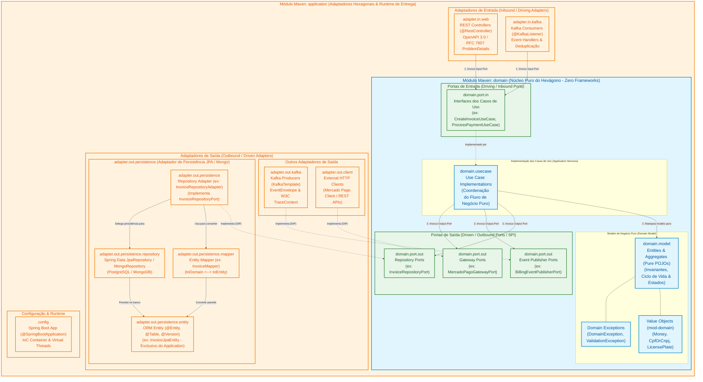

# Biblioteca Compartilhada Central (`15soat-phase4-lib-commons`)

Biblioteca multi-módulos centralizada e compartilhada desenvolvida para o Tech Challenge da Fase 4 da pós-graduação em Software Architecture (SOAT) da FIAP.

## Estrutura de Módulos

A biblioteca segue uma rigorosa separação de responsabilidades inspirada nos padrões corporativos para microsserviços:

- **`mod-domain`**: Regras de negócio puras, exceções de domínio canônicas (`DomainException`, `ResourceNotFoundException`, `AlreadyExistsException`, `ValidationException`) e *Value Objects* (`CpfOrCnpj`, `LicensePlate`, `Email`, `Money`). **Zero dependências externas de frameworks** no núcleo puro (sem acoplamento a Spring ou anotações invasivas).
- **`mod-web`**: Suporte transversal à camada Web, incluindo tratamento padronizado de erros RFC 7807/9457 `ProblemDetail` via `CommonsExceptionAdvice`, propagação de `traceId`/`spanId` no MDC do SLF4J via `LogInterceptor`, e DTOs padronizados de resposta (`GenericResponseDto`, `ErrorResponseDto`).
- **`mod-kafka`**: Abstrações canônicas de streaming de eventos (`EventEnvelope<T>`, `EventMetadata`), serializadores/desserializadores JSON robustos e injeção/extração de headers no padrão W3C TraceContext (`traceparent`) para rastreabilidade distribuída de ponta a ponta.
- **`mod-postgres`**: Utilitários para persistência relacional com JPA/Hibernate (`BaseJpaEntity`, `AuditableEntity`), controle de concorrência otimista (`@Version`) e paginação dinâmica padronizada (`PageRequestUtils`).
- **`mod-mongo`**: Utilitários para persistência NoSQL orientada a documentos no MongoDB / AWS DocumentDB (`BaseMongoDocument`, `AuditableDocument`) e conversores UTC para `ZonedDateTime`.
- **`mod-aot`**: Registrador de dicas de execução AOT da GraalVM em Java puro (`CommonsRuntimeHintsRegistrar`) para compilação nativa de alta performance sem necessidade de arquivos externos de metadados JSON.
- **`mod-test`**: Regras canônicas de governança e arquitetura com ArchUnit (`CommonArchitectureTest`) para validação estática de conformidade arquitetural.
- **`mod-integration-test`**: Fixtures padronizadas de testes de integração com Testcontainers (`PostgresSetup`, `KafkaSetup`, `MongoSetup`, `LocalStackSetup`), WireMock (`WiremockSetup`) e RestAssured para suítes de testes automatizados com infraestrutura real em contêineres.

---

## 🏛️ Padrão Arquitetural: Arquitetura Hexagonal em 2 Módulos (`domain` & `application`)

Todos os microsserviços do ecossistema da Fase 4 adotam a **Arquitetura Hexagonal (Ports and Adapters)** implementada estritamente através de **2 Módulos Físicos Maven**, garantindo a separação cristalina entre as regras puras de negócio e os adaptadores técnicos:

```text
├── <microservice>-domain       -> Núcleo do Hexágono: Regras de Negócio Puras, Casos de Uso e Portas (Zero Frameworks)
└── <microservice>-application  -> Adaptadores Hexagonais: REST, Kafka, Persistência (JPA/Mongo) e Runtime Spring Boot
```

1. **Módulo `domain` (Núcleo do Hexágono - Pureza POJO)**:
   - `domain.model`: Entidades puras de negócio, agregados, invariantes e *Value Objects*. **Zero dependências de JPA/Hibernate, Spring ou banco de dados**.
   - `domain.port.in`: Portas de Entrada (*Driving Ports* - interfaces dos Casos de Uso).
   - `domain.port.out`: Portas de Saída (*Driven Ports* - interfaces SPI para Repositórios, Event Publishers e Gateways).
   - `domain.usecase`: Implementação dos Casos de Uso (orquestração do fluxo puro de negócio).
2. **Módulo `application` (Adaptadores de Entrada/Saída & Runtime)**:
   - `adapter.in.*`: Adaptadores Primários (*Driving Adapters* - REST Controllers OpenAPI/RFC 7807, Consumidores Kafka).
   - `adapter.out.persistence.*`: Adaptadores de Persistência (*Driven Adapters* - JPA/Mongo Entities, Mappers, Spring Data Repositories e Repository Adapters).
   - `adapter.out.kafka.*` / `adapter.out.client.*`: Adaptadores Secundários de Mensageria e Clientes HTTP externos.
   - `config`: Configurações do Spring Boot, injeção de dependências IoC, Virtual Threads e hints GraalVM AOT.

---

### 1. Diagrama Hexagonal Canônico nos 2 Módulos Maven

O diagrama abaixo ilustra a visão arquitetural onde o módulo **`application`** atua como a casca executável e provedora de adaptadores, encapsulando no seu centro o módulo **`domain`** como o núcleo puro de negócio via Portas e Inversão de Dependência (DIP):

<div style="overflow-x: auto; width: 100%;">
<style>
  .mermaid svg {
    max-width: none !important;
    min-width: 1550px !important;
    width: 1550px !important;
  }
</style>



</div>

---

### 2. Responsabilidades dos Módulos Maven

#### 🟢 Módulo `domain` (Núcleo do Hexágono)
- **`domain.model`**: Entidades e Agregados em POJOs puros (sem `@Entity`, sem `@Table`). Encapsulam regras e transições de estado (ex: `invoice.markAsPaid()`).
- **`domain.port.in`**: Interfaces que definem as operações disponibilizadas aos clientes externos.
- **`domain.usecase`**: Implementação das regras de orquestração do caso de uso.
- **`domain.port.out`**: Interfaces SPI que definem o contrato de persistência (`InvoiceRepositoryPort`), mensageria e gateways externos.
- **Regra Fundamental**: Zero acoplamento a Spring, JPA, Hibernate ou banco de dados.

#### 🟠 Módulo `application` (Adaptadores & Entrega)
- **`adapter.in.*`**: Adaptadores condutores (Driving Adapters). Recebem requisições HTTP REST ou mensagens Kafka e invocam as portas de entrada do `domain`.
- **`adapter.out.persistence.*`**: Adaptador de persistência (Driven Adapter). Contém o modelo ORM (`*JpaEntity` ou `*MongoDocument`), o mapeador (`*Mapper`), a interface Spring Data (`JpaRepository`) e o adaptador (`*RepositoryAdapter`) que implementa a porta de saída do `domain`.
- **`adapter.out.kafka.*` / `adapter.out.client.*`**: Publicadores de eventos Kafka e clientes de integração HTTP (ex: Mercado Pago).
- **`config`**: Bootstrap da aplicação Spring Boot (`@SpringBootApplication`), injeção de dependências IoC, Virtual Threads e hints GraalVM AOT.

---

### 3. Como o JPA / Banco de Dados é Isolado na Estrutura de 2 Módulos

A separação nos 2 módulos Maven resolve o acoplamento do JPA de forma elegante e padronizada:

1. **Separação Física e Lógica de Modelos**:
   - No módulo **`domain`**: O agregado `Invoice` é um POJO puro de negócio (somente campos, regras de negócio e validações).
   - No módulo **`application`**: A entidade `InvoiceJpaEntity` (em `adapter.out.persistence.entity`) contém as anotações do Jakarta Persistence (`@Entity`, `@Table`, `@Version`).
2. **Fluxo de Persistência com Inversão de Dependência (DIP)**:
   - O Caso de Uso no `domain` invoca `InvoiceRepositoryPort.save(invoice)`.
   - O `InvoiceRepositoryAdapter` (no `application`) recebe o `Invoice` puro de domínio.
   - O `InvoiceMapper` traduz `Invoice` $\longrightarrow$ `InvoiceJpaEntity`.
   - O `InvoiceJpaRepository` (Spring Data) persiste a entidade no PostgreSQL.
   - O retorno é convertido de volta para o objeto puro `Invoice` do domínio.
3. **Isolamento no `pom.xml`**:
   - O `domain/pom.xml` não possui dependências de JPA, Hibernate ou Spring Data.
   - O `application/pom.xml` possui dependência de compilação sobre o `domain`, além das dependências de infraestrutura (`spring-boot-starter-data-jpa`, `postgresql`, `spring-kafka`, etc.).

---

### 4. Mapeamento com os Módulos do `lib-commons`

| Módulo do Commons | Módulo Maven de Destino | Papel no Ecossistema |
| :--- | :--- | :--- |
| **`mod-domain`** | **`domain`** | Value Objects (`Money`, `CpfOrCnpj`, `LicensePlate`), Exceções Canônicas e Validações de Domínio. |
| **`mod-web`** | **`application`** (`adapter.in.web`) | Handler global RFC 7807/9457 (`ProblemDetail`), Log MDC Interceptor (`traceId`/`spanId`) e DTOs base. |
| **`mod-kafka`** | **`application`** (`adapter.in/out.kafka`) | Envelope canônico de streaming (`EventEnvelope<T>`), propagação W3C TraceContext e serialização JSON. |
| **`mod-postgres`** | **`application`** (`adapter.out.persistence`) | Entidades base JPA (`BaseJpaEntity`), controle de concorrência otimista (`@Version`) e paginação padronizada. |
| **`mod-mongo`** | **`application`** (`adapter.out.persistence`) | Documentos base MongoDB (`BaseMongoDocument`), auditoria e serializadores UTC. |
| **`mod-aot`** | **`application`** (`config`) | Runtime hints e metadados de reflexão para compilação nativa GraalVM. |
| **`mod-test`** | **`domain`** / **`application`** (`src/test`) | Regras de governança arquitetural com ArchUnit. |
| **`mod-integration-test`** | **`application`** / **`iandt`** (`src/test`) | Fixtures e setups de Testcontainers (PostgreSQL, Kafka, Mongo, LocalStack) e WireMock. |

> 📚 **Fontes / Referências Canônicas**:
> - **Alistair Cockburn**: *"Hexagonal Architecture - Ports and Adapters Pattern"*, Alistair.Cockburn.us, 2005.
> - **Robert C. Martin (Uncle Bob)**: *"Clean Architecture: A Craftsman's Guide to Software Structure and Design"*, Pearson Education, 2017 (Capítulo 22: The Clean Architecture).
> - **Eric Evans**: *"Domain-Driven Design: Tackling Complexity in the Heart of Software"*, Addison-Wesley, 2003 (Capítulo 4: Isolating the Domain).


## Stack Tecnológica & Compatibilidade

- **Linguagem**: Java 25 LTS (OpenJDK)
- **Framework Base**: Spring Boot 4.0.7 / Spring Framework 7
- **Ferramenta de Build**: Apache Maven 3.9+
- **Testes Automatizados**: JUnit 5 Jupiter, AssertJ

## Compilação e Instalação Local

Para compilar, executar a suíte de testes unitários e instalar todos os módulos no repositório Maven local (`~/.m2/repository`):

```bash
mvn clean install
```

## 🏛️ Architecture Decision Records (ADRs)

Catálogo centralizado de decisões arquiteturais transversais aplicadas a todos os microsserviços da Fase 4:

- **[Catálogo Global de ADRs](docs/adr/README.md)**: 6 registros formais de decisão (Padrão Database-per-Service, Arquitetura Orientada a Eventos e Saga Coreografada via Kafka, Concessão Pragmatic DDD com JPA no Domínio, Convenção de Tabelas no Singular, Baseline Java 25 / Spring Boot 4, e Estratégia de Testcontainers & Observabilidade Distribuída).
